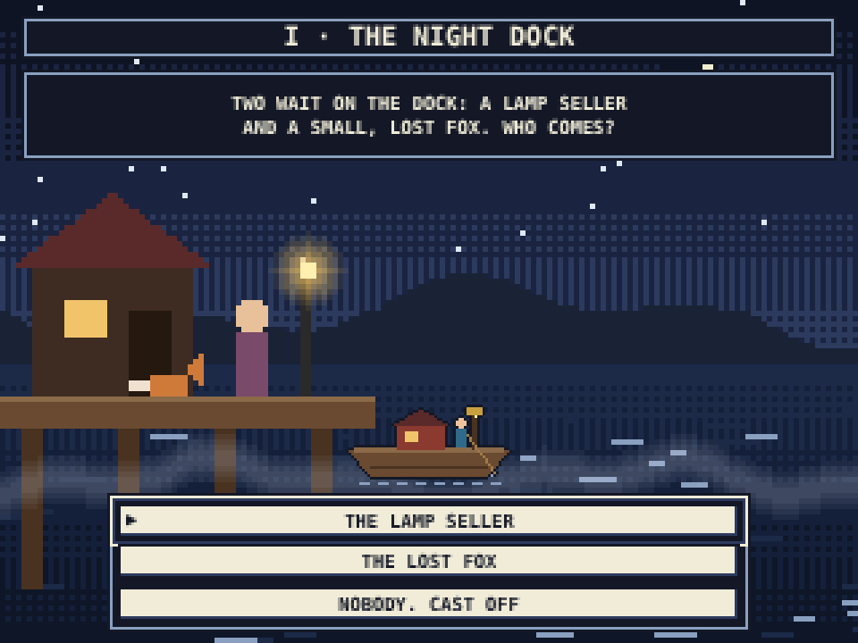
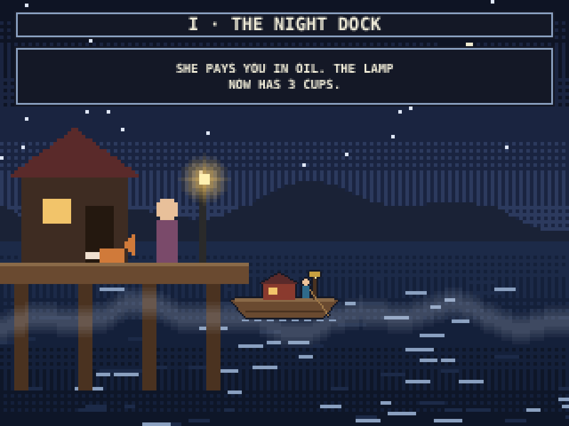
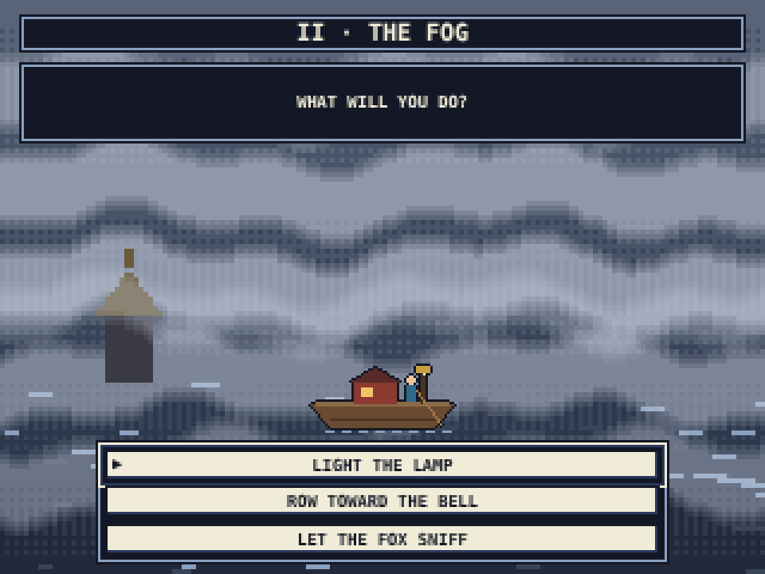
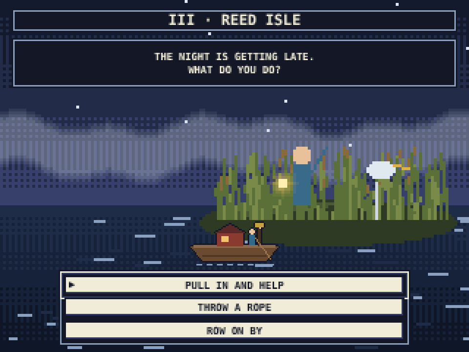
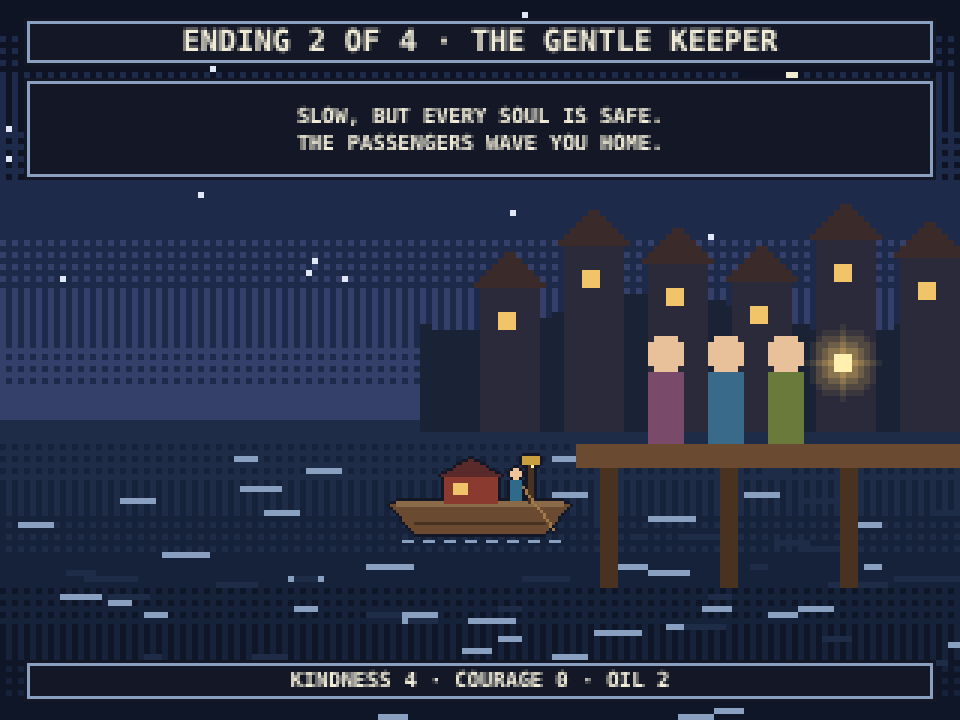
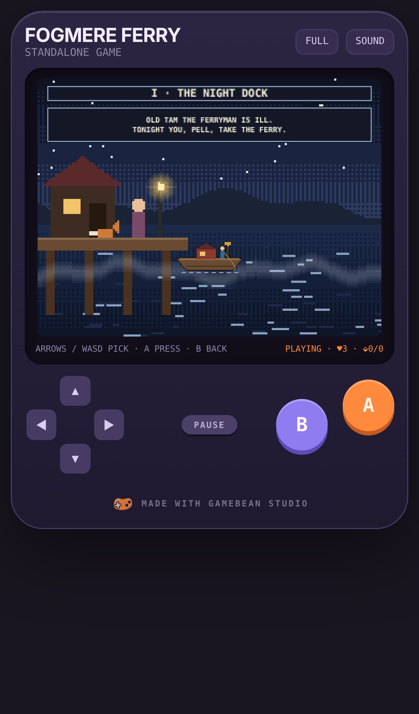

# Fogmere Ferry

A choose-your-path story made with [GameBean Studio](https://github.com/icakinser/gamebean-studio). Pell rows the night ferry across a foggy lake for the first time. Three choices on the way decide which of four endings waits on the far shore.

## Play

- **In a browser:** download `index.html` and open it. On a phone, tap a choice.
- **In GameBean Studio:** **FILE > Open…** > **Browse this computer…** and pick `fogmere-ferry-cartridge.json` (or `index.html`) to open it in the editor. It is also under **Full games** in **FILE > New Game…**.

The controls are listed under **Controls in the finished game** below.

| | |
| --- | --- |
|  |  |
|  |  |
|  |  |

---

## Build it yourself

**Fogmere Ferry** is a choose-your-path story. Old Tam the ferryman is ill, so tonight **Pell**, his apprentice, rows the night ferry across the foggy lake for the first time. Three choices on the way decide which of **four endings** waits on the far shore.

1. **The Night Dock:** take the lamp seller (more oil), the lost fox, or nobody.
2. **The Fog:** light the lamp, row toward the bell, or let the fox sniff the way.
3. **Reed Isle:** help the stranded heron keeper, throw a rope, or row on by.
4. **The Far Shore:** your **kindness** and **courage** pick the ending: the Lantern Festival, the Gentle Keeper, the Bold Crossing, or Lost in the Fog.

There is no hero to move. Each scene is a picture, a narrator and a menu of choices. It shows off:

- A **Label** narrator that tells the scene a line at a time (**Set label text** and **Wait**), with live numbers like `{oil}`.
- A **Panel** with a **Menu** that stores your choice in a variable, and a **Select case** that changes the story's numbers.
- **Fade screen** between scenes, **Go to level** to the next one.
- A **Sequence** bean (a bell, a flash and a shudder, one after another) started by a rule's **Run bean**.
- One **Calculate** that works out the ending: `if(kind >= 3 and brave >= 2, 1, if(kind >= 3, 2, if(brave >= 2, 3, 4)))`.
- **Change music** to a second **Music maker** song on the shore, and **Sound maker** sounds.

**What you will learn:** how to tell a story with rules, how choices add up to an ending, and how to reuse one scene's machinery for the next.

**Time:** about 40 minutes.

---

## Before you start

### Learn the editor moves

If you have not used the GameBean Studio editor before, read **[GameBean Studio editor basics](EDITOR-BASICS.md)** first. The moves you will repeat most:

| The tutorial says                          | You do                                                                                                                    |
| ------------------------------------------ | ------------------------------------------------------------------------------------------------------------------------- |
| **Place a Spikes**                         | Toolbox > **OBJECTS** tab > click **Spikes** > click the map > click **DONE** ([§8](EDITOR-BASICS.md#8-place-an-object))  |
| **Name it Narrator, at `8, 26, 304 × 34`** | Type the name, then X, Y, W and H ([§9](EDITOR-BASICS.md#9-name-an-object-and-type-its-position-and-size))                |
| **Remove Hazard**                          | Click the **×** on the Hazard card ([§10](EDITOR-BASICS.md#10-bean-cards-turn-off-reorder-remove-and-change-settings))    |
| **Add Label (Actions)**                    | **ADD ACTION** > type "Label" > click **Label** ([§11](EDITOR-BASICS.md#11-add-a-bean))                                   |
| **Sprite `dock/idle.png`**                 | **SPRITE** > **IMPORT PNG / SHEET** > pick the file > **SAVE SPRITE** ([§15](EDITOR-BASICS.md#15-sprites-import-or-draw)) |
| **`WHEN On start · DO …`**                 | **ADVANCED** > **ADD LOGIC RULE** ([§14](EDITOR-BASICS.md#14-rules-when--do-))                                            |

### Get the sprite files

The pictures are in [`sprites/fogmere-ferry`](sprites/fogmere-ferry): `dock/idle.png`, `fog/idle.png` and `fog/bell.png` (the buoy appears), `isle/idle.png`, `shore/idle.png` with `shore/e1.png` to `e4.png` (one picture per ending), and `ferry/idle-1.png`, `idle-2.png` (the ferry bobbing). They are 160 × 120 pictures that stretch to fill the screen.

### Keep the finished game open for comparison

**FILE > New Game…** > **FOGMERE FERRY** (under Full games) in a second window. Play it twice and choose differently.

### Controls in the finished game

| Key or touch  | Does            |
| ------------- | --------------- |
| Tap           | Tap a choice    |
| Up / Down + A | Choose and pick |
| Enter         | Pause           |

---

## Part 1: Set up the game

1. **BUILD** > **FILE > New Game…** > **BLANK GAME**. Name the scene **THE NIGHT DOCK**, 320 × 240.
2. **LEVEL SETTINGS**: **CAMERA** = **Fixed**, **SKY** = **Night**, **HORIZON** = **None**.
3. A palette **Fogmere**: Ink `#141826`, Dark `#2c3a5e`, Light `#8aa0c0`, Paper `#f0ecd8`.
4. **VARIABLES**:

   | Slot | Name     | Start | Holds                         |
   | ---- | -------- | ----- | ----------------------------- |
   | 1    | `kind`   | 0     | Kindness                      |
   | 2    | `brave`  | 0     | Courage                       |
   | 3    | `oil`    | 1     | Cups of lamp oil              |
   | 4    | `fox`    | 0     | 1 if the fox came aboard      |
   | 5    | `pick`   | 0     | The choice just made (1 to 3) |
   | 6    | `ending` | 0     | The ending number (1 to 4)    |

5. **SOUNDS**: Sound 1 **Fog bell** (a **Blip** with the **Triangle** wave, low pitch and a long fade), Sound 2 **Oar splash** (a **Hit** with the **Noise** wave).
6. **MUSIC**: **Fogmere**, slow (tempo 76) in A minor, **PLAYS AS** = **Song 1 + Main theme**; **The Far Shore**, brighter (tempo 96) in C major, **PLAYS AS** = **Song 2 only**.
7. The **Hero**: name it **Pointer**, at `304, 224, 12 × 16`, remove all its beans, see-through sprite. A hero with no beans lets the arrows and A work the menu.

---

## Part 2: The first scene's pictures and words

| Name          | At                  | Beans (Hazard removed)                                          | Sprite / UI TEXT                     |
| ------------- | ------------------- | --------------------------------------------------------------- | ------------------------------------ |
| Backdrop      | `0, 0, 320 × 240`   | none                                                            | `dock/idle.png`                      |
| Ferry         | `128, 150, 64 × 32` | none                                                            | `ferry/idle-1…2.png`, FRAME TIME 0.6 |
| Chapter title | `8, 6, 304 × 16`    | **Label**: Text size Medium, Align Centre, Look Dark box        | `I · THE NIGHT DOCK`                 |
| Narrator      | `8, 26, 304 × 34`   | **Label**: Text size Small, Align Centre, Look Dark box         | (empty)                              |
| Settings      | `304, 0, 16 × 16`   | **Environment settings**: Top bar (hearts, score, clock) = Hide | (empty, see-through sprite)          |

---

## Part 3: The narrator tells the scene

Select **Narrator** > **ADVANCED** > **ADD LOGIC RULE**: `WHEN On start`. **DO**:

1. **Fade screen** (in, dark, 0.8 s)
2. **Set label text**: `OLD TAM THE FERRYMAN IS ILL.` and, on a new line, `TONIGHT YOU, PELL, TAKE THE FERRY.` · **Play sound** (ui) · **Wait** 3.2
3. **Set label text**: `THE FAR SHORE IS ACROSS FOGMERE.` / `THE LAMP HAS {oil} CUP OF OIL.` · **Play sound** (ui) · **Wait** 3.2
4. **Set label text**: `TWO WAIT ON THE DOCK: A LAMP SELLER` / `AND A SMALL, LOST FOX. WHO COMES?` · **Play sound** (ui) · **Wait** 0.6
5. **Send message** `choose`

`{oil}` shows the variable's value as the line appears.

Then add one rule per reply, so the choice can make the narrator speak:

| Message  | Set label text                                                  |
| -------- | --------------------------------------------------------------- |
| `reply1` | `SHE PAYS YOU IN OIL. THE LAMP` / `NOW HAS {oil} CUPS.`         |
| `reply2` | `THE FOX CURLS UP ON A COIL` / `OF ROPE AND WATCHES THE WATER.` |
| `reply3` | `YOU PUSH OFF ALONE. THE DOCK` / `LIGHTS SHRINK BEHIND YOU.`    |

---

## Part 4: The choices

1. **Choices panel**: a **Spikes** at `40, 184, 240 × 52`, Hazard removed, with **Panel** (Panel number 1, Look Dark window, **Starts open** = No, While open = Game keeps playing). Rules:
   - `WHEN On message (choose) · DO Show / hide (show)`
   - `WHEN On message (chosen) · DO Show / hide (hide)`
2. **Choices**, on top of it: a **Spikes** at `44, 188, 232 × 44` with **Menu** (Text size Small, Look Light, **Store choice in** = Variable 5 `pick`, Send the option as a message = No). **UI TEXT**, one per line: `THE LAMP SELLER`, `THE LOST FOX`, `NOBODY. CAST OFF`.
3. Its rule, `WHEN On menu choice`:
   - **Send message** `chosen` (the panel closes, so you can't choose twice)
   - **Play sound** (ui, Sound maker: **Oar splash**)
   - **Select case** on `pick`:
     - **CASE 1**: **Add to variable** `kind` 1, **Add to variable** `oil` 2, **Send message** `reply1`
     - **CASE 2**: **Add to variable** `kind` 1, **Set variable** `fox` = 1, **Send message** `reply2`
     - **CASE 3**: **Add to variable** `brave` 1, **Send message** `reply3`
   - **Wait** 3.4
   - **Fade screen** (out, dark, 0.8 s), **Wait** 0.9
   - **Go to level**: the next scene (**THE FOG**, once you have made it).

> **Check:** **PLAY**. Three lines appear one after another, then the choices. Pick one: the narrator answers and the screen fades.

---

## Part 5: The Fog, with a bell

1. Copy the whole scene (**Ctrl+A**, **Ctrl+C**), **+ NEW SCENE**, paste. Name it **THE FOG** (Fixed camera, Night sky, Fogmere palette).
2. **Backdrop**: sprite `idle` = `fog/idle.png`, and a second animation `bell` = `fog/bell.png`.
3. The bell is a **Sequence** on the Backdrop. Add **Sequence** (Actions): **Pause between** 0.6, **Repeat** Once, **When** = **Only when run by a bean**. In its **RUN THESE BEANS** area ([§13](EDITOR-BASICS.md#13-beans-that-run-other-beans-key-input-timer)) add, in order:
   - **Sound cue**: Sound = **Sound 1** (Fog bell), When = Only when run by a bean
   - **Screen flash**: Color Light, Duration 0.3, When = Only when run by a bean
   - **Camera shake**: Strength 2, Duration 0.5, When = Only when run by a bean
4. Backdrop rule: `WHEN On message (ring) · DO Run bean (Sequence), Play animation (bell)`.
5. **Chapter title**: `II · THE FOG`.
6. **Narrator** On start lines: `HALFWAY OVER, THE FOG CLOSES IN.` / `YOU CANNOT SEE THE BOW.` — then, right after its **Wait** 3.2, **Send message** `ring` — then `A BELL RINGS, LOW AND SLOW,` / `SOMEWHERE OFF TO THE LEFT.` and `WHAT WILL YOU DO?`.
7. **Choices** UI TEXT: `LIGHT THE LAMP`, `ROW TOWARD THE BELL`, `LET THE FOX SNIFF`. Two of these turn out two ways, so their cases send their own reply:
   - **CASE 1**: **If / Else**, IF **variable compare** `oil >= 1`: **Add to variable** `oil` -1, **Add to variable** `kind` 1, **Send message** `reply1`. ELSE: **Add to variable** `brave` 1, **Send message** `alt1`.
   - **CASE 2**: **Add to variable** `brave` 1, **Send message** `reply2`.
   - **CASE 3**: **If / Else**, IF **variable compare** `fox = 1`: **Add to variable** `brave` 1, **Add to variable** `kind` 1, **Send message** `reply3`. ELSE: **Send message** `alt3`.
8. The narrator's reply rules:

   | Message  | Set label text                                                               |
   | -------- | ---------------------------------------------------------------------------- |
   | `reply1` | `THE LAMP SHOWS THE BUOYS. {oil} CUPS` / `OF OIL LEFT. YOU STEER SAFELY ON.` |
   | `alt1`   | `NO OIL LEFT! YOU STEER BY THE` / `STARS YOU REMEMBER, HEART POUNDING.`      |
   | `reply2` | `YOU ROW HARD AT THE SOUND.` / `A BUOY SLIDES PAST, CLOSE!`                  |
   | `reply3` | `THE FOX SNIFFS, THEN POINTS ITS NOSE.` / `YOU FOLLOW IT OUT OF THE FOG.`    |
   | `alt3`   | `THERE IS NO FOX ABOARD. YOU WAIT,` / `AND DRIFT, AND WAIT SOME MORE.`       |

9. Go back to **THE NIGHT DOCK** and point its **Go to level** at **THE FOG**.

---

## Part 6: Reed Isle

1. Paste again into a third scene, **REED ISLE**. Backdrop `isle/idle.png` (remove the Sequence and the `ring` rule), Chapter title `III · REED ISLE`.
2. Narrator lines: `THE FOG THINS BY REED ISLE.` / `SOMEONE IS WAVING FROM THE REEDS.`, then `THE HERON KEEPER, STRANDED,` / `WET THROUGH AND SHIVERING.`, then `THE NIGHT IS GETTING LATE.` / `WHAT DO YOU DO?`.
3. Choices: `PULL IN AND HELP` (**Add to variable** `kind` 2), `THROW A ROPE` (`kind` 1 and `brave` 1), `ROW ON BY` (nothing). Each sends its `replyN`:
   - `reply1`: `YOU WRAP THE KEEPER IN YOUR` / `COAT. THE HERON RIDES ON THE BOW.`
   - `reply2`: `YOU TOW THE KEEPER'S SKIFF` / `BEHIND YOU, STEADY AND SLOW.`
   - `reply3`: `YOU CALL THAT YOU WILL SEND` / `HELP, AND ROW ON INTO THE DARK.`
4. Point **THE FOG**'s Go to level at **REED ISLE**.

---

## Part 7: The far shore and its four endings

1. **+ NEW SCENE**: **THE FAR SHORE**, Fixed, Night sky, Fogmere palette. Point Reed Isle's Go to level here.
2. **Backdrop**: `idle` = `shore/idle.png`, plus animations `e1`, `e2`, `e3`, `e4` with the four ending pictures. Four rules: `WHEN On message (ending1) · DO Play animation (e1)`, and the same for 2, 3 and 4.
3. **Ferry**, **Settings** and the **Pointer** hero as before.
4. **Chapter title** (`IV · THE FAR SHORE`) with four rules: `WHEN On message (ending1) · DO Set label text (ENDING 1 OF 4 · THE LANTERN FESTIVAL)`; ending2 `ENDING 2 OF 4 · THE GENTLE KEEPER`; ending3 `ENDING 3 OF 4 · THE BOLD CROSSING`; ending4 `ENDING 4 OF 4 · LOST IN THE FOG`.
5. **Narrator**, one rule, `WHEN On start`:
   - **Fade screen** (in, dark, 0.8 s)
   - **Change music**: **The Far Shore**
   - **Set label text** `THE FAR SHORE COMES OUT OF THE NIGHT...`, **Wait** 2.6
   - **Calculate** `ending` = `if(kind >= 3 and brave >= 2, 1, if(kind >= 3, 2, if(brave >= 2, 3, 4)))`
   - **Select case** on `ending`:
     - **CASE 1**: **Set label text** `THE WHOLE TOWN WAITS WITH LANTERNS.` / `TAM WILL BE PROUD OF YOU.`, **Send message** `ending1`
     - **CASE 2**: `SLOW, BUT EVERY SOUL IS SAFE.` / `THE PASSENGERS WAVE YOU HOME.`, **Send message** `ending2`
     - **CASE 3**: `THE FASTEST CROSSING IN YEARS.` / `YOU WATCH THE SUN COME UP ALONE.`, **Send message** `ending3`
     - **CASE ELSE**: `YOU DRIFT UNTIL DAWN AND LAND` / `ON THE WRONG SHORE. TRY AGAIN?`, **Send message** `ending4`
   - **Wait** 5, **Send message** `the end`
6. **Tally**: a Label at `8, 220, 304 × 14` (Small, Centre, Dark box): `KINDNESS {kind} · COURAGE {brave} · OIL {oil}`. Its rule ends the game with the ending's name: `WHEN On message (the end)` · **Select case** on `ending`: **CASE 1** **Win / lose the game** (win, `THE LANTERN FESTIVAL`), **CASE 2** (win, `THE GENTLE KEEPER`), **CASE 3** (win, `THE BOLD CROSSING`), **CASE ELSE** (win, `LOST IN THE FOG`).

The formula reads: kind **and** brave enough is ending 1; only kind is ending 2; only brave is ending 3; neither is ending 4.

---

## Part 8: Play it

1. **PLAY**. Read, choose, and watch the story turn.
2. Try for each ending. Hint: the Lantern Festival needs 3 kindness **and** 2 courage, so you must be both kind and brave at least once.

> **If something is off:** the choices never appear? The narrator's last action must send `choose`, and the panel needs a rule that hears it. A choice makes no difference? The Menu must store the choice in `pick` before the Select case reads it. The ending is always 4? Check the formula, and that each case adds to `kind` or `brave`.

---

## Make it your own

- **A longer journey:** add a scene between Reed Isle and the shore (an island lighthouse? a storm?), with its own three choices.
- **Your own endings:** change the formula. A fifth ending for `oil >= 3`? Add `if(oil >= 3, 5, ...)` at the front, a CASE 5 and an `e5` picture.
- **Remember choices:** with `fox = 1`, give the shore a line about the fox jumping ashore.
- **Your own words:** every line is a **Set label text**; change them all and it is a new story.
